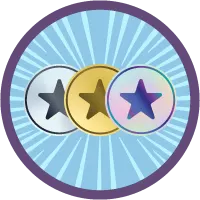
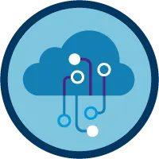
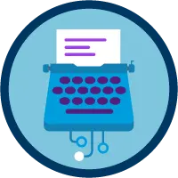
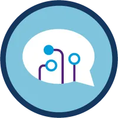
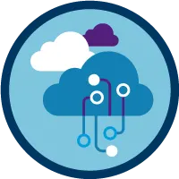

# 🚀 Salesforce Trailhead Journey

Hello! I'm Paulo Renato dos Santos Souza and this repository documents my learning journey in AI and Agentforce, aiming to become an **Agentblazer Champion**.

## 📅 My Learning Timeline

- **August 2026:** Completed Module 1 (Becoming an Agentblazer) and Module 2 (AI Fundamentals).
- **September 2026:** Completed Module 3 (Generative AI), Module 4 (NLP), and Module 5 (Parsing).
- **October 2026:** Completed Module 6 & 7 (LLMs & Salesforce), Module 8 (AI Fluency), and the Human-AI Collaboration & Human Advantage units.

## 🏆 Badges Earned

-  **Becoming an Agentblazer** - Earned on 01/08/2026 (100 points)
-  **Artificial Intelligence Fundamentals** - Earned on 23/08/2026 (200 points)
-  **Generative AI Basics** - Earned on 10/09/2026 (200 points)
-  **Natural Language Processing Basics** - Earned on 13/09/2026 (200 points)
-  **Large Language Models** - Earned on 17/09/2026 (200 points)

## 📚 Completed Modules

- [x] Module 1: Becoming an Agentblazer
- [x] Module 2: Artificial Intelligence Fundamentals
- [x] Module 3: Generative AI
- [x] Module 4: Natural Language Processing (NLP)
- [x] Module 5: Parsing and Semantic Analysis
- [x] Module 6 & 7: LLMs in Practice & Salesforce
- [x] Module 8: AI Fluency & Perspective
- [x] Human-AI Collaboration & Human Advantage

## 🎯 Next Steps

- Complete the Champion trail.
- Advance to the Innovator level.
- Apply this knowledge at Zimpóriuns.

## 🔗 Connect with me

- [LinkedIn](https://www.linkedin.com/in/prjavalis)
- [My Trailhead Profile](https://www.salesforce.com/trailblazer/prjavalis)

---

# 🚀 Jornada no Salesforce Trailhead

Olá! Sou Paulo Renato dos Santos Souza e este repositório documenta minha jornada de aprendizado em IA e Agentforce, com o objetivo de me tornar um **Agentblazer Champion**.

## 📅 Minha Linha do Tempo de Estudos

- **Agosto de 2026:** Concluí o Módulo 1 (Tornando-se um Agentblazer) e o Módulo 2 (Fundamentos de IA).
- **Setembro de 2026:** Concluí o Módulo 3 (IA Generativa), Módulo 4 (NLP) e Módulo 5 (Parsing).
- **Outubro de 2026:** Concluí os Módulos 6 e 7 (LLMs e Salesforce), Módulo 8 (Fluência em IA) e as unidades de Colaboração Humano-IA e Vantagem Humana.

## 🏆 Badges Conquistados

-  **Tornar-se um Agentblazer** - Concluído em 01/08/2026 (100 pontos)
-  **Noções básicas de inteligência artificial** - Concluído em 23/08/2026 (200 pontos)
-  **Noções básicas de IA generativa** - Concluído em 10/09/2026 (200 pontos)
-  **Noções básicas de Processamento de linguagem natural** - Concluído em 13/09/2026 (200 pontos)
-  **Grandes modelos de linguagem** - Concluído em 17/09/2026 (200 pontos)

## 📚 Módulos Concluídos

- [x] Módulo 1: Tornando-se um Agentblazer
- [x] Módulo 2: Fundamentos de IA
- [x] Módulo 3: IA Generativa
- [x] Módulo 4: Processamento de Linguagem Natural (NLP)
- [x] Módulo 5: Parsing e Análise Semântica
- [x] Módulos 6 e 7: LLMs na Prática e Salesforce
- [x] Módulo 8: Fluência em IA e Perspectiva
- [x] Colaboração Humano-IA e Vantagem Humana

## 🎯 Próximos Passos

- Concluir a trilha Champion.
- Avançar para o nível Innovator.
- Aplicar o conhecimento na Zimpóriuns.

## 🔗 Conecte-se comigo

- [LinkedIn](https://www.linkedin.com/in/prjavalis)
- [Meu perfil no Trailhead](https://www.salesforce.com/trailblazer/prjavalis)
